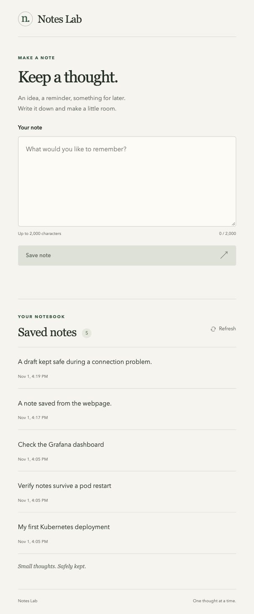

# Notes Lab

A small web notebook for ideas, reminders, and things to come back to.

Write a note, select **Save note**, and find it in your saved notes. Notes Lab keeps your notes in PostgreSQL, so they are available when you return.

## What you can do

- Write and save notes of up to 2,000 characters.
- Read your latest notes, newest first, and refresh the list.
- See when each note was created.
- Keep your draft if a save fails, then try again when the connection returns.

The notes page opens at `/`. The developer API documentation is available at `/docs`.

## How it works

The browser talks to a small FastAPI backend. Saving a note writes to PostgreSQL; loading the list reads it back. A save is confirmed after the API succeeds.

The interface, stylesheet, and JavaScript ship in the same Python container. There is no separate frontend service or frontend build step.

| Component | Purpose |
|---|---|
| Python / FastAPI | Serves the notes page and API. |
| PostgreSQL | Stores the saved notes. |
| Prometheus | Collects application request counts, response status, and duration metrics. |
| Grafana | Visualizes the metrics in dashboards. |

## What PostgreSQL stores

Each saved note is one row in the `notes` table:

| Field | Content |
|---|---|
| `id` | An automatically generated note number. |
| `text` | The note you wrote. |
| `created_at` | The creation date and time, with timezone. |

Notes are stored in PostgreSQL rather than browser local storage. Retaining the database's persistent volume keeps them across application and database pod recreation.

## Runtime and API

Notes Lab runs on Python 3.12 with PostgreSQL 17. The application listens on port `8000` and requires `APP_ENV` at runtime. For a local deployment, use `APP_ENV=local`.

The [application reference](axercise/06-application-reference.md) lists the full configuration, health endpoints, API, and metrics.

## Deployment exercise

This repository is also the starter for a platform engineering deployment exercise. Its supplied Dockerfile contains runtime faults to investigate as part of the handover.

The scenario, instructions, and submission details live in **[axercise/](axercise/README.md)**, split into short parts so you can work through one stage at a time.

**[Start the exercise →](axercise/README.md)**
